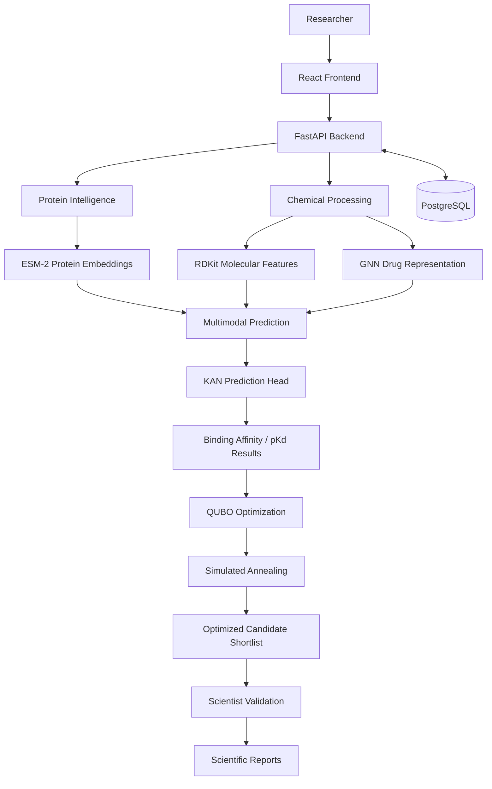

# 🧬 HelixQ

### Multimodal Drug–Target Interaction Prediction & Quantum-Inspired Candidate Optimization

**Accelerating computational drug discovery through protein intelligence, molecular learning and quantum-inspired optimization.**

HelixQ is a full-stack AI-powered drug discovery platform that combines protein sequence embeddings, molecular representations, deep learning and QUBO-based optimization to support virtual drug screening and candidate selection.

It brings together biological sequence analysis, cheminformatics, binding-affinity prediction and candidate optimization in a unified research workflow.

---

## Overview

Traditional drug discovery relies heavily on expensive and time-consuming laboratory screening. HelixQ explores a computational approach by integrating multiple AI and optimization techniques into a single platform.

The system combines:

* **Protein Intelligence:** ESM-2-based protein sequence representations.
* **Molecular Intelligence:** RDKit-based chemical processing and molecular fingerprints.
* **Deep Learning:** GNN-based molecular representation and KAN-based prediction architecture.
* **Binding Affinity:** Drug–target interaction analysis and pKd prediction.
* **Candidate Optimization:** QUBO formulation and Simulated Annealing.
* **Scientific Validation:** Human-in-the-loop candidate review and report generation.

## Key Features

| Feature                | Description                                                         |
| ---------------------- | ------------------------------------------------------------------- |
| Protein Analysis       | Protein sequence retrieval and physicochemical property analysis    |
| Molecular Processing   | SMILES parsing, molecular descriptors and Morgan fingerprints       |
| Virtual Screening      | AI-assisted drug–target interaction and binding-affinity prediction |
| Chemical Filtering     | Lipinski Rule of Five evaluation                                    |
| Similarity Analysis    | Tanimoto-based molecular similarity and redundancy assessment       |
| Candidate Optimization | QUBO-based candidate selection using Simulated Annealing            |
| Scientist Validation   | Human review and validation of selected candidates                  |
| Scientific Reports     | PDF, CSV and JSON report generation                                 |

## System Architecture



*Architecture illustrates the intended multimodal workflow. Individual model connections should be interpreted according to their implemented status.*

## How It Works

### 1. Protein Intelligence

HelixQ supports protein target analysis using protein sequence information.

* Retrieves protein information through UniProt integration.
* Processes amino acid sequences.
* Generates protein representations using ESM-2.
* Calculates physicochemical properties.

### 2. Molecular Intelligence

Drug candidates are processed using RDKit.

* SMILES parsing and molecular validation.
* Molecular descriptor calculation.
* Morgan fingerprint generation.
* Lipinski Rule of Five filtering.
* Tanimoto similarity analysis.

### 3. Multimodal Drug–Target Prediction

The prediction pipeline combines information from protein and molecular representations.

* ESM-2 provides protein sequence embeddings.
* Molecular graph representations capture drug structure.
* GNN-based learning extracts molecular features.
* A KAN-based prediction architecture supports binding-affinity estimation.

The objective is to evaluate potential drug–target interactions and generate binding-affinity predictions.

### 4. Quantum-Inspired Candidate Optimization

After prediction, HelixQ uses a combinatorial optimization stage to identify promising candidate combinations.

The optimization process uses:

* Quadratic Unconstrained Binary Optimization (QUBO).
* Candidate scoring and selection weights.
* Chemical similarity penalties.
* Simulated Annealing through the D-Wave Ocean SDK.

This is a **quantum-inspired optimization approach using a classical simulated annealing solver**, not execution on quantum hardware.

### 5. Human Validation and Reporting

The platform supports researcher review of candidate results.

* Candidate approval and rejection.
* Additional validation decisions.
* Persistent validation records.
* Scientific report generation.
* PDF and CSV exports.

## Technology Stack

| Category           | Technologies                                    |
| ------------------ | ----------------------------------------------- |
| Frontend           | React, TypeScript, Vite                         |
| UI & Visualization | Tailwind CSS, Framer Motion, Recharts, Three.js |
| Backend            | Python, FastAPI                                 |
| Machine Learning   | PyTorch, ESM-2, GNN, KAN                        |
| Cheminformatics    | RDKit                                           |
| Optimization       | D-Wave Ocean SDK, QUBO, Simulated Annealing     |
| Database           | PostgreSQL, SQLAlchemy                          |
| Data Sources       | UniProt, ChEMBL                                 |
| Authentication     | JWT, Passlib                                    |
| Deployment         | Docker, Docker Compose                          |

## Application Screenshots

Screenshots of the actual HelixQ application will be added here.

Recommended screenshots:

* Main dashboard.
* Protein analysis interface.
* Drug screening results.
* Candidate optimization visualization.
* Scientific report interface.

## Project Structure

```text
helixq/
├── backend/
│   ├── app/
│   │   ├── database/
│   │   ├── exceptions/
│   │   ├── middleware/
│   │   ├── models/
│   │   ├── repositories/
│   │   ├── routers/
│   │   ├── schemas/
│   │   └── services/
│   ├── requirements.txt
│   └── test_helixq_end_to_end.py
│
├── frontend/
│   ├── src/
│   │   ├── api/
│   │   ├── components/
│   │   ├── contexts/
│   │   ├── hooks/
│   │   ├── pages/
│   │   ├── routes/
│   │   └── types/
│   └── package.json
│
├── docker/
├── docker-compose.yml
└── .env.example
```

## Getting Started

HelixQ uses a React frontend, FastAPI backend and PostgreSQL database.

### Prerequisites

* Python
* Node.js and npm
* PostgreSQL
* Docker and Docker Compose

### Setup

Clone the repository:

```bash
git clone https://github.com/Siva402-ai/helixq.git
cd helixq
```

Configure environment variables using the provided `.env.example`.

For the backend, install dependencies:

```bash
cd backend
pip install -r requirements.txt
```

For the frontend:

```bash
cd frontend
npm install
```

Use the repository's Docker Compose configuration for containerized deployment.

Refer to the backend and frontend configuration files for the exact startup commands and environment requirements.

## Engineering Highlights

* Integrated protein sequence intelligence with molecular cheminformatics.
* Designed a multimodal drug–target prediction workflow.
* Explored KAN-based prediction architectures.
* Applied QUBO formulation to candidate selection.
* Integrated Simulated Annealing for quantum-inspired optimization.
* Developed a full-stack research interface using React and FastAPI.
* Incorporated researcher validation and scientific report generation.

## Future Scope

* Improve model performance through larger and more diverse datasets.
* Expand molecular representation and multimodal fusion strategies.
* Evaluate prediction quality against experimental benchmarks.
* Explore additional optimization objectives.
* Extend explainability and reproducibility of candidate selection.

---

**HelixQ — Connecting AI, computational biology and optimization for drug discovery.**
